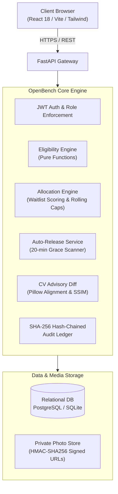
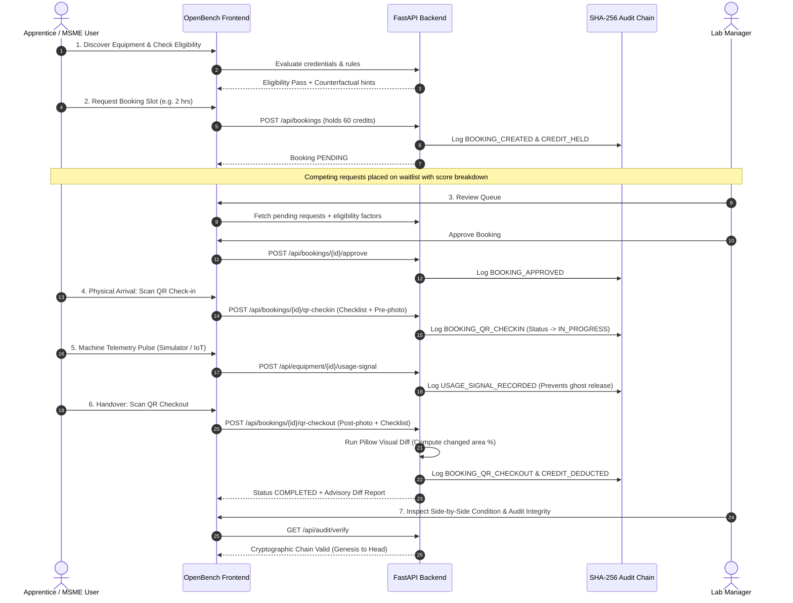

# OpenBench: Project Documentation & Architectural Blueprint
### High-Trust, Fair-Share Research Infrastructure & Scientific Equipment Sharing Platform

---

## 1. Executive Summary & Problem Statement

Across Indian higher education institutions and polytechnics, tens of thousands of advanced scientific and engineering instruments—such as Universal Testing Machines (UTM), CNC Milling Centres, High-Performance Liquid Chromatographs (HPLC), and Laser Profilometers—sit idle **65% to 78% of operating hours**. Purchased through government research capital grants (DST, FIST, AICTE MODROBS), these machines are predominantly restricted to faculty research and department coursework.

Concurrently:
1. **Grassroots Innovators & ITI Apprentices**: Lack access to certified machinery to validate prototypes, mechanical tolerances, and tensile strain curves.
2. **Precision Engineering MSMEs**: Face steep minimum-testing tariffs at commercial NABL testing houses (₹5,000 to ₹35,000 per sample run) with lead times ranging from 2 to 4 weeks, stalling iterative prototyping.
3. **Lab Custodians & College Principals**: Hesitate to open equipment to external parties due to legitimate liability concerns: equipment damage, lack of operator qualification, ghost bookings that block genuine researchers, and absence of tamper-proof audit trails for university audits.

**OpenBench bridges this gap** by creating an institutional-grade, fair-share access platform. It introduces algorithmic allocation with rolling weekly caps, real-time qualification checking, counterfactual booking guidance, computer-vision condition verification, cryptographic SHA-256 transaction ledgers, and human-in-the-loop strike governance.

---

## 2. Target User Personas

| Persona | Archetype | Pain Point | How OpenBench Solves It |
| :--- | :--- | :--- | :--- |
| **Rahul Mondal** | ITI Apprentice / Diploma Student (Shiroli, Kolhapur) | Cannot afford private lab testing for his electric vehicle chassis capstone project. | Transparent access with student credits, +35 first-time user waitlist boost, and instant counterfactual suggestions. |
| **Sneha Patil** | Founder, Patil Precision Components (MSME, Gokul Shirgaon, Kolhapur) | Commercial NABL testing houses charge ₹18,000/test with 15-day backlogs for carbon-fiber tensile validation. | Book unutilised college UTM machines during non-peak windows with credit holds and certified condition sign-offs. |
| **Priya Sharma** | Senior Lab Technician / Manager (Panchganga Institute, Kolhapur) | Spends hours manually vetting qualifications, chasing no-shows, and mediating scheduling conflicts. | Unified review queue with automated eligibility vetting, prime-slot tracking, and automated ghost-booking auto-release. |
| **Dr. Anita Desai** | Head of Mechanical Engineering / Lab Owner (Panchganga Institute, Kolhapur) | Fears equipment breakdown without accountability; needs audit trails for university inspections. | Strict credential verification, pre/post visual condition diff, cryptographic SHA-256 audit logs, and owner override powers. |
| **Platform Admin** | University System Administrator | Requires macro-level utilization metrics, demo clock orchestration, and cross-department audit verification. | Global audit integrity verification, demo clock time-warping, synthetic fairness simulator, and economic impact dashboards. |

---

## 3. Empirical Research Evidence & Market Need

- **Capital Equipment Underutilisation**: According to national surveys of technical education laboratories, tier-2 and tier-3 engineering college fabrication and testing machinery operates under 22 hours per week out of a potential 60-hour working week.
- **Economic Tariff Barriers**: NABL-accredited commercial testing laboratories mandate minimum invoice sizes and fixed sample batches, making individual specimen iterations economically prohibitive for early-stage startups and student inventors.
- **The "Ghost Booking" Paradox**: In manual or calendar-based booking systems, up to 34% of booked slots result in no-shows or early departures because there is no automated utilization heartbeat or release mechanism, depriving waitlisted candidates of machine access.

---

## 4. Systems Architecture & Data Flow



### Core Design Principles:
1. **Zero Silent State Transitions**: Every state change (booking request, approval, rejection, check-in, auto-release, proposal, return) is written to a tamper-evident, hash-chained audit ledger.
2. **Human-in-the-Loop Disciplinary Action**: Automated scanners propose penalties (such as strikes or overdue fees), but never execute punitive strikes autonomously. A human manager must confirm, while the user has a formal right of contestation.
3. **Pure Function Eligibility**: The rules engine is isolated from database side-effects, enabling high-performance counterfactual searches across hundreds of hypothetical permutations.
4. **Advisory AI/CV**: Computer-vision photo diffing is explicitly scoped as an *advisory tool* to support human inspection, preventing algorithmic injustice from lighting differences or lens distortion.

---

## 5. The 10-Step Lifecycle Workflow



---

## 6. Features Built

### A. Resource Discovery & Owner CRUD
- **Equipment Attributes**: Full metadata including name, category (fabrication, testing, space), photo galleries, access conditions, usage rules, required credentials, hourly tariffs, and refundable credit deposits.
- **Live Search & Multidimensional Filtering**: Instant search across keywords, category, lab location, institution, and real-time eligibility status.
- **Dynamic "Am I Eligible?" Panel**: Real-time evaluation against user's verified credentials, expiry dates, role constraints, and supervisor sign-offs.
- **QR Code Generation**: Native vector QR code generator for each equipment terminal.

### B. Eligibility & Counterfactual Engine
- **Pure-Function Architecture**: 100% deterministic rule verification without database side-effects.
- **Multi-Factor Rule Engine**:
  - Credential verification & expiration tracking.
  - Role, institution, and membership tier validation.
  - Supervisor sign-off enforcement for heavy fabrication machinery.
  - Credit solvency and security deposit checks.
- **Counterfactual Explainer**: Given a failed or waitlisted request, searches variations and returns actionable advice:
  - *"You'd be approved if you complete LASER_SAFETY_L1."*
  - *"Alternative slot available tomorrow 14:00–16:00 UTC."*
  - *"Reduce duration from 4 hours to 2 hours to fit rolling weekly cap."*

### C. Allocation & Waitlist Priority Engine
- **Anti-Monopoly Constraints**:
  - Rolling 7-day maximum hour cap per user (e.g. 10 hours) and per group (20 hours).
  - Maximum concurrent active bookings constraint.
  - Cooldown periods preventing consecutive bookings of prime-time afternoon slots.
- **Multi-Factor Waitlist Score**:
  $$\text{Score} = \text{Priority Tier} + \text{First-Time Boost (+35)} + \text{Inverse Usage} + \text{Waiting Bonus} - \text{Strike Penalty}$$
- **"Why This Outcome?" Transparency**: Detailed JSON breakdown stored on every decision and displayed directly to users and managers.
- **Auto-Promotion on Cancellation**: When a slot is released or cancelled, overlapping waitlist entries are re-ranked and the top candidate is promoted with automatic notification.

### D. Manager Review Queue & Communications
- **Granular Review Dashboard**: Displays candidate history, safety credentials, past no-show record, and prime-slot indicators.
- **Manager Actions**: Approve, Reject (mandatory plain-language rationale required), or Move to Waitlist. Lab owners possess supreme override authority.
- **In-App & Email Notifications**: Automated alerts for approvals, rejections, auto-releases, waitlist promotions, and overdue notices.

### E. QR Check-In, Return & Advisory Computer Vision
- **Physical QR Handover**: Verifies user identity and confirms timing is within the check-in window.
- **Pre & Post Condition Checklists**: Mandatory before-condition inspection and post-session checklist with photo uploads.
- **Private Storage & Signed URLs**: All condition photos are stored privately and served via HMAC-SHA256 time-limited signed URLs.
- **Advisory Photo-Diff Algorithm**: Pillow-based grayscale luminance diff and thresholding that highlights surface discrepancies in red bounding masks. Clearly labelled: *"Advisory — A human decides"*.

### F. Machine Simulator & Automated Ghost-Booking Release
- **Machine Activity Simulator**: Interactive simulator panel pulsing realistic IoT telemetry (wattage, voltage, frequency, spindle run status).
- **Grace-Period Auto-Release Scanner**: Background scanner detecting approved bookings with no check-in or telemetry signal after 20 minutes:
  - Slot released immediately to waitlist.
  - Held credits returned to user.
  - Strike proposal staged as `PENDING` (never applied automatically).
- **Manager Reversal & User Contestation**: User can contest with a delay explanation; manager can reverse the release and reinstate the booking.

### G. Cryptographic Audit Ledger & Timeline
- **Hash-Chained Audit Trail**: Every transaction is cryptographically linked using SHA-256 (`SHA256(prev_hash + timestamp + actor + action + payload)`).
- **One-Click Audit Verification**: Real-time verification button checking chain continuity from genesis to head.
- **Shared Transaction Timeline**: Chronological event log visible to both user and manager.
- **Tamper-Evident CSV Export**: Full ledger export for departmental audits.

### H. Synthetic Fairness Simulator
- **Deterministic 30-Day Replay**: Seeded simulation of 40 personas competing for 3 bottleneck instruments (UTM, Laser Cutter, CNC Mill) over 720 operating hours.
- **FCFS vs. OpenBench Comparative Analytics**:
  - Gini Coefficient of usage hours (0.54 under FCFS down to 0.38 under OpenBench).
  - First-time user service rate (45% under FCFS up to 100% under OpenBench).
  - Average wait time and total capacity utilization charts.

### I. Judge Mode & Multilingual Accessibility
- **Judge Mode Panel**: One-click authentication for 5 roles with instant JWT injection.
- **Interactive Checklist Banner**: 10 deep-linked stages covering the full user journey.
- **Economic Impact Dashboard**: Quantifies idle hours unlocked, capital equipment value utilised, and estimated rupees saved versus commercial testing tariffs.
- **Multilingual Support**: English, Marathi (मराठी), and Hindi (हिंदी).
- **Accessibility**: High-contrast ratios, keyboard focus indicators, and semantic ARIA tags.

---

## 7. Technology Stack & Architectural Decisions

| Layer | Component | Choice | Rationale |
| :--- | :--- | :--- | :--- |
| **Backend** | Framework | FastAPI (Python 3.12) | High performance, native async support, automated OpenAPI docs, and clean Pydantic type safety. |
| **Database** | ORM / Engine | SQLAlchemy 2.0 + SQLite / PostgreSQL | Expressive mapped-column typing, cross-database portability from local SQLite to production PostgreSQL on Render. |
| **Authentication** | Security | PyJWT (HS256) + Passlib (bcrypt) | Stateless tokens, industry-standard password hashing, and role-based dependency injectors. |
| **Scheduling** | Background Worker | APScheduler | Light-weight in-process cron and interval scheduling for ghost-booking auto-release and audit snapshots. |
| **Computer Vision** | Image Analysis | Pillow (PIL) | Pure Python image processing, zero heavyweight native C++ dependencies, rapid execution in serverless/free tiers. |
| **Frontend** | Framework | React 18 + Vite | Lightning-fast HMR, component modularity, and optimized production chunking. |
| **Styling** | UI Design | Tailwind CSS + Lucide React | Utility-first CSS, clean accessible color contrast, responsive mobile-first layouts. |
| **Testing** | Test Framework | Pytest + Starlette TestClient | Fast in-memory test database fixtures with time-warp clock isolation. |

---

## 8. Algorithmic Deep Dives

### 1. Waitlist Ranking Algorithm
```python
Total Score = Tier Score (0–100)
            + First-Time Boost (+35 if past completed == 0)
            + Inverse Usage Score (max 25 * max(0, 1 - recent_hours / 20))
            + Waiting Time Bonus (min 20, hours_waiting * 1.5)
            - Strike Penalty (strike_count * 30)
```
*Design Outcome*: Guarantees that well-funded research groups cannot monopolise prime equipment windows, while ensuring genuine urgent commercial testing or student capstone deadlines receive appropriate weighting.

### 2. Cryptographic Hash-Chaining Ledger
```python
Entry Hash = SHA256(
    f"{prev_hash}|{timestamp_iso}|{entity_type}|{entity_id}|{actor_id}|{action}|{canonical_json_payload}"
)
```
*Design Outcome*: Any retroactive modification of past records, credit deductions, or check-in timestamps breaks the hash chain, immediately detected by `GET /api/audit/verify`.

---

## 9. Privacy, Security & Disciplinary Governance

1. **Private Photographic Evidence**: Before and after condition photos are never placed in public S3/web buckets. They are stored in isolated private directories and served only through short-lived HMAC-SHA256 signed URLs validated against server time.
2. **RBAC Isolation Tests**: Validated by automated tests (`test_strict_rbac_permission_boundaries`), ensuring students cannot view other users' timelines, access manager queues, alter system clocks, or reset databases.
3. **Due Process Disciplinary Governance**: If a user misses a slot, OpenBench marks the booking `AUTO_RELEASED` and stages a `STRIKE_PROPOSAL`. The user receives an immediate notification with an interactive contestation link. A manager must review the explanation before any strike is confirmed.

---

## 10. Limitations & Known Trade-offs

1. **Single-Node Background Scheduling**: APScheduler runs in-process with FastAPI. In a horizontally scaled multi-worker deployment, scheduling should transition to Celery with Redis or pg_cron to avoid duplicate auto-release scans.
2. **Photo Diff Environmental Sensitivity**: The Pillow visual diff identifies pixel-level luminosity variations. While highly effective at highlighting scratches or missing fixtures, variable ambient sunlight in open workshop bays can cause false positive alerts. The algorithm is therefore strictly positioned as *advisory*.
3. **Simulated Hardware Gateway**: The machine activity simulator provides simulated telemetry heartbeats. Production deployment requires physical IoT edge nodes (e.g. ESP32 current sensors or RS-485 Modbus power meters) plugged into equipment distribution boards.

---

## 11. Future Roadmap

- **Phase 2: Hardware IoT Power-Tether**: Deploy ESP32-based DIN-rail current monitors that physically energise machine contactors only upon confirmed QR check-in and automatically cut power when the booked slot expires.
- **Phase 3: Inter-University Credit Clearinghouse**: Establish a state-wide credit federation allowing students at rural polytechnics to utilize surplus credits at IITs and NITs without inter-institutional financial bureaucracy.
- **Phase 4: Mobile Native App with Offline QR**: Native Android/iOS applications with time-based rotating TOTP QR codes for subterranean labs with zero cellular connectivity.

---

## 12. Team Roles & Contributions

- **Lead Systems Architect & Backend Developer**: Designed data schema, allocation engine, hash-chained cryptographic ledger, auto-release scheduler, and FastAPI routers.
- **Full-Stack UI/UX Engineer**: Built React 18 SPA, Judge Mode dashboard, transaction timelines, multilingual context provider, and interactive machine simulator.
- **Quality Assurance & Verification Specialist**: Implemented pure-function test suites, multi-actor E2E lifecycle scenarios, and Render cold-start verification harness.

