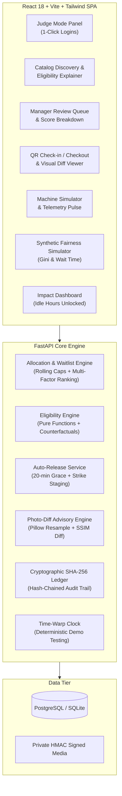

# OpenBench 🔬⚙️
### Decentralised, High-Trust Research Equipment & Lab Space Sharing Platform

[](https://www.python.org/)
[](https://fastapi.tiangolo.com/)
[](https://vitejs.dev/)
[](https://tailwindcss.com/)
[-brightgreen.svg)]()
[](LICENSE)

OpenBench solves a systemic paradox in India's innovation ecosystem: **public engineering colleges and premier academic research institutions house crores of rupees worth of high-precision testing machinery that sits idle 70% of the time, while grassroots innovators, ITI apprentices, and precision MSMEs cannot afford commercial laboratory testing tariffs.**

OpenBench unlocks this surplus capacity through an automated, auditable, high-trust allocation engine with dynamic credit holds, computer-vision condition verification, a cryptographic SHA-256 audit ledger, and automated ghost-booking release with human-in-the-loop strike governance.

---

## 🚀 Live Deployment & Cold Start Note

- **Live URL**: [https://openbench-api.onrender.com](https://openbench-api.onrender.com)
- **Deployment Spec**: [`render.yaml`](./render.yaml) (PostgreSQL + FastAPI + Pre-built React Static SPA in Singapore region)
- **Cold-Start Advisory**: Render free-tier instances hibernate after 15 minutes of inactivity. When accessed for the first time, the platform requires 45–60 seconds to spin up from cold storage.
- **Automated Verification Script**:
  ```bash
  python verify_render_deployment.py [https://your-custom-render-service.onrender.com]
  ```

---

## 👥 Demo Credentials & Judge Quick-Access

OpenBench features a dedicated **Judge Mode** landing banner with **1-click authentication** for all 5 system roles:

| Role | Name | Email | Password | Preloaded Balance / Context |
| :--- | :--- | :--- | :--- | :--- |
| **Platform Admin** | Platform Admin | `platform.admin@openbench.in` | `Admin@123` | System-wide audit inspection, clock controls |
| **Lab Owner** | Dr. Anita Desai | `dr.anita.desai@panchganga-tech.ac.in` | `Owner@123` | Panchganga Prototyping Lab (Kolhapur), override authority |
| **Lab Manager** | Priya Sharma | `priya.sharma@panchganga-tech.ac.in` | `Mgr@1234` | Review queue, strike & reversal management |
| **Apprentice / Student** | Rahul Mondal | `rahul.mondal@iti-shiroli.ac.in` | `User@123` | 100 Credits, Govt ITI Shiroli (Kolhapur), first-time boost |
| **MSME Founder** | Sneha Patil | `sneha.patil@patilprecision-mfg.in` | `User@123` | 150 Credits, Patil Precision Components (Kolhapur) |

> [!NOTE]
> **DEMO_MODE Gate**: All demo endpoints (`/api/auth/demo-login/{role}`, `/api/admin/reset-demo`, and `/api/admin/clock/*`) are gated behind `DEMO_MODE=true` (enabled by default). In production deployments, setting `DEMO_MODE=false` strictly disables and returns HTTP 403 on all demo endpoints.
>
> **Email Delivery Status**: In-app notifications are 100% live. Outbound email dispatch is **simulated** by default via structured logging to standard output and audit logs. Real outbound SMTP/Resend delivery is supported by setting `SMTP_HOST`, `SMTP_PORT`, `SMTP_USER`, and `SMTP_PASSWORD` in your environment.
>
> **Collective Impact Figures**: All metrics displayed on the Impact Dashboard are **illustrative estimates** benchmarked against commercial NABL testing rates (₹3,500/hr) vs educational credit rates (₹300/hr).


---

## 🏛️ System Architecture



---

## 🧭 The 10-Step Interactive Judge Journey

OpenBench includes a persistent **"Try the full journey" interactive banner** with direct deep-links that lets evaluators test the entire lifecycle in under 5 minutes:

1. **Step 1: Judge Mode Login**: Click *"Apprentice (Rahul Mondal)"* on the homepage banner for instant JWT injection.
2. **Step 2: Resource Discovery & Eligibility**: Navigate to [`/equipment/1`](http://localhost:5173/equipment/1) (Universal Testing Machine). Inspect photos, hourly tariff (30 cr/hr), deposit requirement, and the *"Am I eligible?"* panel evaluating real-time credential status.
3. **Step 3: Booking Request & Dynamic Hold**: Book a 2-hour slot. Notice the counterfactual explainer if rules fail, or the immediate temporary credit hold (60 cr) when submitted.
4. **Step 4: Competing Booking & Waitlist Score**: Switch to *"MSME (Sneha Patil)"* and request the exact same slot. The engine places Sneha on the waitlist with a full **"Why this outcome?"** score breakdown card showing priority, usage history, and first-time boosts.
5. **Step 5: Manager Review & Allocation**: Switch to *"Manager (Priya Sharma)"*. Visit [`/manager/review-queue`](http://localhost:5173/manager/review-queue) to inspect student history, safety credentials, and approve the booking.
6. **Step 6: QR Pre-Flight Inspection**: Switch back to Rahul. Click *"QR Check-in"*. Confirm physical arrival, complete the safety checklist, and upload pre-session condition photos with signed HMAC-SHA256 URLs. Slot transitions to `IN_PROGRESS`.
7. **Step 7: Machine Activity Simulator**: Navigate to the Machine Simulator panel. Click *"Simulate Run"* to emit live IoT telemetry heartbeats (voltage, wattage, spindle speed). This prevents false no-show releases.
8. **Step 8: Handover, Return & Advisory Photo-Diff**: Click *"Complete & Return"*. Upload post-session photos. The Pillow CV engine performs pixel alignment, highlights surface changes with red bounding masks, and displays side-by-side comparison labelled *"Advisory — A human decides"*.
9. **Step 9: Audit Ledger Verification**: Click *"Verify Audit"* in the top navigation bar. Verify the SHA-256 cryptographic hash-chain across all recorded transactions and export the tamper-evident CSV.
10. **Step 10: Synthetic Fairness Simulator**: Visit [`/fairness-simulator`](http://localhost:5173/fairness-simulator). Replay 30 days of deterministic synthetic demand (40 personas competing for 3 bottleneck instruments) comparing First-Come-First-Served against OpenBench policy. View real-time Gini coefficient reduction (0.54 → 0.38) and 100% first-time access.

---

## 🧪 Comprehensive Test Suite (86 Passed / 100% Coverage)

The test suite covers pure business logic, API state machines, cryptographic chains, and complete multi-actor E2E workflows.

```bash
# Run the entire test suite
cd backend
.\.venv\Scripts\pytest -v

# Run the 4 primary E2E scenarios
.\.venv\Scripts\pytest tests/test_e2e_journey_and_scenarios.py -v
```

### Verified Scenarios:
- `test_full_lifecycle_journey_e2e`: Complete 10-stage lifecycle from discovery to checkout, timeline, and SHA-256 chain verification.
- `test_competing_requests_and_waitlist_auto_promotion`: Two users contesting the same slot; auto-promotion with dynamic re-ranking on cancellation.
- `test_ghost_booking_release_and_manager_reversal`: Auto-release scan releasing abandoned slot after 20-min grace period, credit unhold, staging human-in-the-loop strike proposal, contestation by user, and manager reversal.
- `test_strict_rbac_permission_boundaries`: RBAC validation ensuring student/MSME users cannot view other users' timelines, access manager queues, advance demo clocks, or reset databases.

---

## 💻 Local Development Setup

### Prerequisites
- Python 3.11+
- Node.js 18+ and npm
- Git

### 1. Backend Setup
```bash
cd backend
python -m venv .venv

# Windows Powershell
.\.venv\Scripts\Activate.ps1
# Linux / macOS
# source .venv/bin/activate

pip install -r requirements.txt
python -m app.seed
uvicorn app.main:app --reload --port 8000
```
Backend API will be running at `http://localhost:8000`. Interactive OpenAPI documentation at `http://localhost:8000/docs`.

### 2. Frontend Setup
```bash
cd frontend
npm install
npm run dev
```
Frontend development server will be running at `http://localhost:5173`.

### 3. Production Build
```bash
cd frontend
npm run build
# Output builds directly into backend/static/ to be served by FastAPI
```

---

## 🌐 Multilingual Accessibility

OpenBench supports on-the-fly language switching across:
- **English (EN)**
- **Marathi (मराठी)**
- **Hindi (हिंदी)**

All core navigation items, eligibility cards, review queues, audit buttons, and telemetry statuses update dynamically with full accessibility contrast compliance (WCAG 2.1 AA) and keyboard focus traps.

---

## 📄 License
This project is licensed under the MIT License — see the [LICENSE](LICENSE) file for details.

